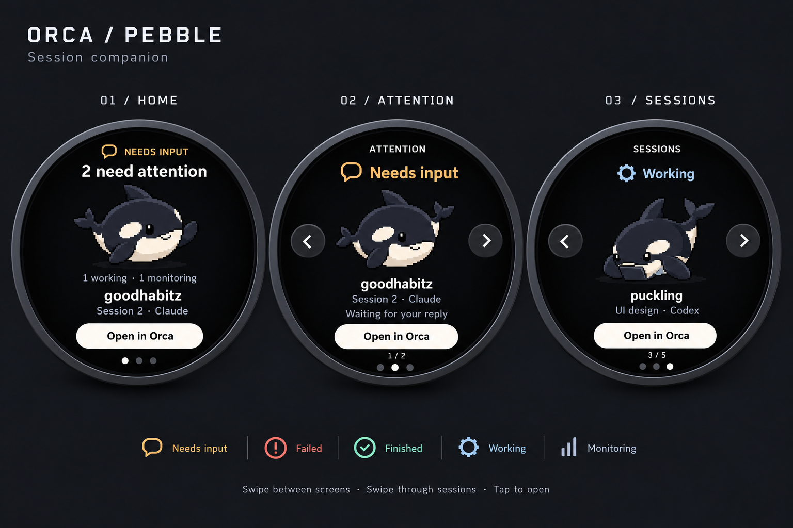
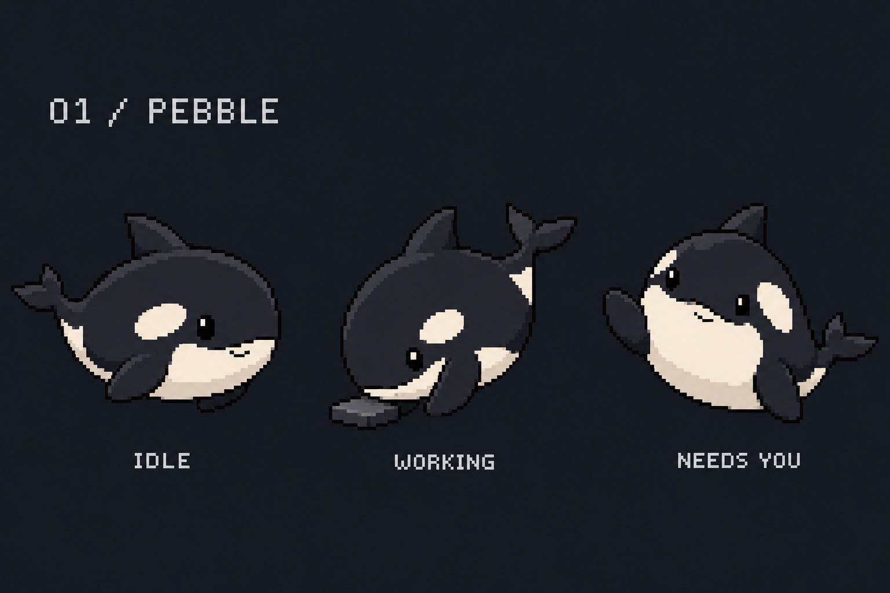

# Pebble session companion

Puckling is a physical companion for Orca sessions across projects, Claude Code, and Codex. Its purpose is to show which session needs the user and open that exact existing session in one tap. Pebble is an expressive pixel-art orca that reinforces explicit status icons and labels.

The user approved this direction and the screen design. This document is the implementation brief and design reference. Implement the whole flow autonomously on the implementation branch, commit meaningful milestones, and validate it in the simulator before reporting completion.

## Approved visual references

These concept images were generated with the built-in image generation tool and selected by the user. They are visual references, not production sprite sheets or evidence of implemented behavior. The written behavior below governs interaction details the image cannot show. Adapt spacing and type sizes for the actual 466 by 466 round display.

## Product direction

- Cover all unarchived Orca projects by default, including multiple sessions per workspace and both terminal and native chat sessions.
- Put questions, blockers, and failed runs before completed results. Include new completed results below those requests in the attention queue.
- Keep active and recent sessions available in a session browser. Exclude older inactive history from the default list. Choose a simple documented recency policy and stable ordering.
- Make routine implementation decisions without asking the user. Finish the implementation, tests, simulator validation, and documentation in this session.
- Remove Tamagotchi mechanics from the active product and roadmap: feeding, calories, transcript ingestion for food, hunger, neglect, sickness, poop, growth, evolution, babies, token diets, and gifts. There is no pet care loop. Status expressions and personality remain useful.
- The repo name can remain puckling. Present the product as an Orca session companion with Pebble.

## Character and theme

Pebble is the compact round orca calf in the approved character sheet. Keep the bean-shaped body, blunt snout, stubby dorsal fin, small paddle flippers, tiny forked tail, ivory chin and belly, white oval eye patches, small actual dark eyes, and crooked smile. Avoid the earlier slender, angular, or glossy blue-eyed designs.

Use crisp pixel art on a consistent logical pixel grid, drawn at integer scale without smoothing. Use a small charcoal, navy, slate, and warm-ivory palette. Build real reusable sprite assets or pixel data with clear provenance. Match Pebble's silhouette and poses closely; a procedural blob or enlarged concept board does not satisfy the design.

- Idle: gentle hovering, blinking, occasional tail movement.
- Working: round body leans toward a small work tile; focused eyes and engaged flippers.
- Needs input: faces the user with a politely raised paddle flipper.
- Finished: a brief restrained happy pose, with completion also shown as a label and icon.
- Failed: a mild concerned pose with a persistent failure label; no alarm loop.

The interface uses AMOLED black, graphite surfaces, warm-white text, and white pill actions. Use amber for input, coral for failure, mint for completion, and muted blue-gray for work and monitoring. Color supports an icon and words. The character's markings stay consistent across states. Use readable type and large touch targets inside the circular safe area. Protect the AMOLED with dimming or subtle movement when appropriate.

## Screens

### Home

Show an explicit attention count, Pebble, a subdued working/monitoring summary, and the next pending session's project and short session identity. A large Open in Orca action focuses that displayed session. The approved image illustrates two attention requests and goodhabitz Session 2 / Claude; these are sample data, not hardcoded live entries.

When nothing needs the user, show All clear, let Pebble occupy more space, and offer Browse sessions. When there are no sessions, show a deliberate empty state. When disconnected or stale, show Status unknown or Connection lost with a freshness indication. Do not present stale data as confirmed idle or allow stale navigation.

### Attention

Show one readable request card at a time: state icon and label, project, short session identity, reason when reliable, and Open in Orca. Display position such as 1 / 2. Previous/next controls supplement swipe navigation. Completed results belong below actionable requests.

A worktree unread flag is not proof that each agent in it has an unread result. Do not turn historical done sessions into fresh alerts on startup. Track observed completion and acknowledgement deliberately. Opening a request acknowledges seeing it but does not imply its question was answered or its failure fixed. Keep unresolved requests visible without repeatedly sounding or forcing the same already-opened request as the next action when others remain unseen. Define these rules in the code and docs.

### Sessions

Browse active and recent sessions across projects, with the same project, session label, agent type, state icon, position, and Open action. Include working, monitoring, finished, and attention states. Distinguish multiple sessions in the same project. Use reliable available titles or short stable fallback labels; do not run an LLM merely to invent session titles. Avoid sending prompts or terminal transcripts to the puck.

## Navigation and focus

- Horizontal swipe changes Home, Attention, and Sessions. Show three page dots with the current screen selected.
- Vertical swipe moves between cards in Attention and Sessions. Respect gesture thresholds so dragging never also opens a session.
- Tap the displayed Open action to focus the exact existing Orca tab and pane. Never create a tab as part of navigation.
- Preserve selected identity across incoming snapshots. A new alert must not silently replace the card under the user's finger. If it disappears, show that it ended or became unavailable, then allow an intentional next selection. Do not substitute another session for the action just tapped.
- Revalidate the selected identity and freshness before focus. Show Opening, then Opened or a useful retry state based on the actual navigation receipt. Prevent duplicate concurrent focus requests.
- Preserve support for local native chats and terminal sessions. Clearly report unsupported or unavailable targets.
- Touch is primary. Lift-to-wake, face-down mute, and optional twist-to-step are useful enhancements if feasible after the core flows. The microphone, approval/denial input, and remote prompt answering are outside scope.
- The default notification policy is persistent visual plus one short soft cue per new attention event, batching closely spaced events and respecting mute. Keep the visual flow fully usable without sound. Any audio or IMU functionality not implemented or not hardware-verified must be labeled honestly in the docs and final report.

## Integration and implementation constraints

Read the repository instructions and relevant existing code before editing. Read ~/llmfiles/shared/CLAUDE.md. Read ~/llmfiles/codex/compatibility.md if using shared review workflows or GitLab text. Use installed skills when applicable. For Orca CLI work, read its version-matched orca-cli guide and verify commands with --help and a real --json call before relying on them.

The existing implementation polls Orca every two seconds, reduces state to one expression, sends version-1 scalar snapshots with a 255-byte line cap, and opens a dynamically selected session on any tap. Those constraints are insufficient for this design. Deliberately evolve the session model, input/focus path, and protocol to carry bounded individual session data, selected identities, freshness, and action feedback. Update both simulator and physical firmware together. Validate limits, partial serial messages, malformed input, and stale links. Keep terminal contents and full prompts out of the device protocol and logs.

Use Orca's reliable state and outcome fields. A done run can have a failure outcome. Monitoring is distinct from productive work. Validate waiting and blocked semantics on the installed Orca build. Use a generic Needs input or Needs attention label until more specific evidence supports Question or Approval. Do not infer that every blocked state is a permission request.

The daemon owns session and attention business state. Firmware renders state and reports input. Local view and gesture state may live where it keeps rendering and input responsive. Shared UI and sprite code must run in the simulator and on the physical puck. Keep the working USB bridge and board-specific display/sensor support. The hardware is Waveshare ESP32-S3-Touch-AMOLED-1.75C, not the plain 1.75.

Use the current lightweight renderer unless there is a demonstrated need for a dependency change. Extend the existing architecture rather than replacing working bridges and focus adapters without need. Keep buffers bounded, render efficiently, and preserve firmware buildability. The existing touch layer only reports initial pokes and needs proper gesture tracking for swipes.

## Documentation cleanup

Curate the relevant Markdown files so the repository describes its actual state and this direction consistently:

- README.md: describe the Orca/Pebble companion, actual controls, setup, simulator and USB usage, implementation status, validation, and a practical roadmap without Tamagotchi mechanics.
- docs/architecture.md: remove food/transcript/history-derived creature rules, record the selected design and actual protocol/ownership decisions, and distinguish supported behavior from plans.
- docs/creature.md: replace with Pebble appearance, expressions, animation, and calm notification behavior, or rename and fix all links.
- docs/mvp.md: replace the hunger/token MVP with completion criteria for the session companion.
- docs/orca.md and docs/protocol.md: document actual metadata, identity, ordering, acknowledgement, feedback, versioning, bounds, freshness, and focus behavior.
- docs/hardware.md and docs/prior-art.md: retain verified hardware/reference information and adjust only relevant stale product claims.
- CLAUDE.md and other relevant Markdown: update any stale instructions affected by the implementation. Do not change shared skills or files outside this repo.

Keep this approved reference and its images linked and intact. Remove superseded roadmap text rather than leaving contradictory active plans. Clearly separate shipped features, simulator-only validation, and hardware work still pending.

## Validation and completion

Work in the new feature branch. Commit coherent milestones as implementation progresses, with descriptive messages. Do not squash everything into a final unreviewable commit. Do not push, merge, flash hardware, or launch another implementation session. Continue autonomously through ordinary debugging and implementation choices.

1. Run make test and add meaningful coverage for the changed session/protocol/navigation behavior, including multiple projects, mixed agent types, multiple sessions in a workspace, failures, monitoring, completion acknowledgement, stable selection, exact-target focus, gesture/tap separation, stale links, and unavailable targets.
2. Build the simulator and run make validate-sim, updating its synthetic scenarios for the new flow. Exercise actual shared firmware rendering and input, not only HTML or mocked UI assertions.
3. Save simulator screenshots and logs showing all three screens and representative attention, finished, working, monitoring, empty, disconnected, and failed-focus states. Inspect screenshots for circular clipping, text legibility, touch target spacing, and pixel-art fidelity. Fix visual problems before completion.
4. Exercise navigation and opening with synthetic Orca responses so validation does not unexpectedly switch the user's real sessions. Run a read-only live Orca smoke check when available and clearly distinguish it from deterministic checks.
5. Build firmware with PlatformIO without uploading if the toolchain is available. Record any environment limitation accurately. Never describe a simulator check as a hardware test.
6. Audit the final diff for behavior, scope, stale documentation, and generated build artifacts. Commit source, approved design references, docs, and appropriate reproducible validation evidence. Keep large transient logs/build products in their ignored output locations and link to them from a concise validation report.
7. Finish with branch, commit milestones, changed behavior, checks run with results, screenshot locations, and any material limitations. Leave the worktree clean apart from documented ignored outputs. Do not claim completion if core flows or simulator checks still fail.
